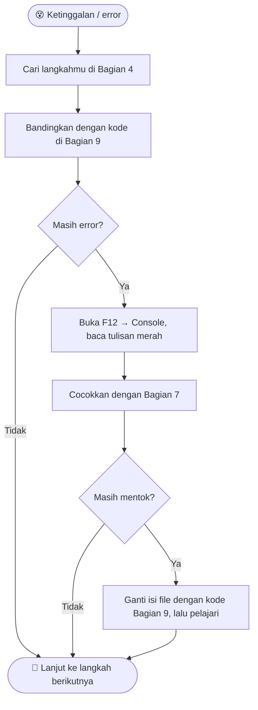
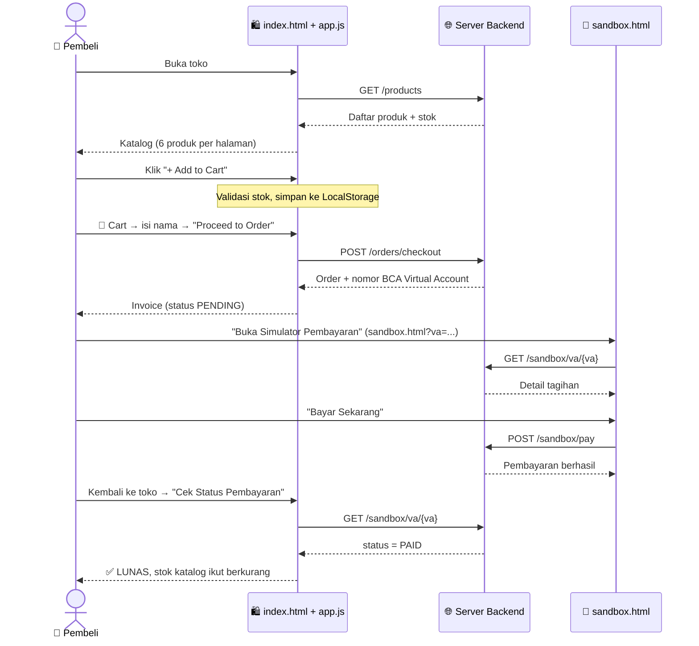

<div align="center">

# 🛍️ TKJ's Store

### Final Project Web Programming — Kelas 10

**Bikin toko online sendiri yang nyambung ke server beneran, lengkap sampai bayar pakai BCA Virtual Account!**


[🚀 Cara Menjalankan](#-3-cara-menjalankan-proyek) · [📋 Langkah Pengerjaan](#-4-langkah-demi-langkah-mengerjakan-proyek) · [🆘 Ketinggalan?](#-5-jangan-panik--panduan-kalau-ketinggalan) · [🎨 Kustomisasi](#-6-panduan-kustomisasi) · [🚨 Error](#-7-error-umum--solusinya) · [📜 Kunci Jawaban](#-9-kode-lengkap-kunci-jawaban)

</div>

---

## 👋 Halo Teman-Teman!

Di proyek ini kamu akan membangun website toko online bernama **TKJ's Store** yang terhubung langsung ke server backend buatan tim kami. Nggak ada data bohongan: produk, stok, dan tagihannya datang dari server sungguhan. 🔥

### ✨ Fitur yang bakal kamu buat

| | Fitur | Yang kamu pelajari |
|---|-------|--------------------|
| 📦 | **Katalog produk** dari server, lengkap dengan stok | `fetch()`, `async/await`, JSON |
| 📄 | **Pagination** (6 produk per halaman) | `slice()`, `Math.ceil()` |
| 🛒 | **Keranjang belanja** + validasi stok, tersimpan di browser | `localStorage`, array, event |
| 🪟 | **Pop-up (modal)** keranjang & invoice | manipulasi DOM, `classList` |
| 🧾 | **Checkout** dan dapat nomor **BCA Virtual Account** | `POST`, form, `preventDefault()` |
| 🏦 | **Simulator m-Banking BCA** untuk bayar sampai lunas | halaman kedua, query string |

> 💡 **README ini bukan cuma daftar langkah.** Isinya juga:
> - 🔧 Cara menjalankan proyek → **Bagian 3**
> - ✅ Checklist per langkah → **Bagian 4**
> - 🆘 Kalau kamu ketinggalan atau ragu → **Bagian 5**
> - 🎨 Di mana ubah warna, font, nama toko, dll → **Bagian 6**
> - 🚨 Daftar error umum & solusinya → **Bagian 7**
> - 📜 Kode lengkap semua file (tinggal copy kalau tertinggal) → **Bagian 9**

---

## 📑 Daftar Isi

1. [🎒 Alat & Struktur File](#-1-alat--struktur-file)
2. [🌐 Server Backend & Swagger](#-2-server-backend--swagger)
3. [▶️ Cara Menjalankan Proyek](#-3-cara-menjalankan-proyek)
4. [📋 Langkah Demi Langkah](#-4-langkah-demi-langkah-mengerjakan-proyek)
5. [🆘 Jangan Panik — Kalau Ketinggalan](#-5-jangan-panik--panduan-kalau-ketinggalan)
6. [🎨 Panduan Kustomisasi](#-6-panduan-kustomisasi)
7. [🚨 Error Umum & Solusinya](#-7-error-umum--solusinya)
8. [💡 Tips & Trik Ngoding](#-8-tips--trik-ngoding)
9. [📜 Kode Lengkap (Kunci Jawaban)](#-9-kode-lengkap-kunci-jawaban)
10. [📖 Ringkasan Alur Website](#-10-ringkasan-alur-website)

---

## 🎒 1. Alat & Struktur File

### Alat yang dipakai

| Alat | Fungsi |
|------|--------|
| 🧑‍💻 **Visual Studio Code** | Tempat menulis kode |
| 🔌 **Ekstensi Live Server** *(opsional, disarankan)* | Membuka website di browser dan auto-refresh tiap kamu save |
| 🌍 **Google Chrome / Microsoft Edge** | Melihat hasil dan mengecek error lewat `F12` |

### Struktur folder

```
frontend/
├── 📄 index.html     ← halaman toko (navbar, hero, katalog, modal keranjang & invoice)
├── 🏦 sandbox.html   ← halaman simulator m-Banking BCA
├── 🎨 style.css      ← semua tampilan (dipakai index.html DAN sandbox.html)
├── ⚙️ app.js         ← semua logika & pemanggilan API (dipakai kedua halaman)
└── 📘 README.md      ← panduan ini
```

| File | Isinya | Jumlah baris |
|------|--------|:------------:|
| `index.html` | Kerangka toko: navbar, hero, katalog, modal keranjang & invoice | 198 |
| `sandbox.html` | Kerangka simulator pembayaran untuk melunasi Virtual Account | 33 |
| `style.css` | Warna, tata letak, modal, badge, dan tampilan HP | 594 |
| `app.js` | Ambil produk, keranjang, checkout, cek status, dan logika simulator | 314 |

> ⚠️ **Penting:** keempat file harus ada di **satu folder yang sama**. `sandbox.html` memakai `style.css` dan `app.js` yang sama dengan `index.html`, jadi semua logika terpusat di satu tempat.

---

## 🌐 2. Server Backend & Swagger

**Backend** adalah server yang menyimpan data barang di database dan memproses pesanan. Website yang kamu buat adalah **frontend**, yaitu tampilan depan yang dilihat pembeli.

| | Link |
|---|------|
| 🔗 **Alamat Server API** | `https://serverstaging-vps-5e6db201b3.asiahub.id/api` |
| 📚 **Dokumentasi Swagger** | [Buka Swagger](https://serverstaging-vps-5e6db201b3.asiahub.id/swagger/index.html) |

### 4 Endpoint yang dipakai di proyek ini

| # | Method | Endpoint | Dipakai untuk | Dipanggil di (`app.js`) |
|:-:|:------:|----------|---------------|:-----------------------:|
| 1 | `GET` | `/products` | Ambil katalog produk beserta stok | `muatProduk()` — baris 11 |
| 2 | `POST` | `/orders/checkout` | Kirim keranjang → dapat order & nomor Virtual Account | submit form — baris 217 |
| 3 | `GET` | `/sandbox/va/{va_number}` | Cek detail tagihan VA (order, total, status) | `cekStatusPembayaran()` — baris 173, `cekTagihan()` — baris 282 |
| 4 | `POST` | `/sandbox/pay` | Simulasi bayar VA sampai lunas | `bayarTagihan()` — baris 294 |

> 📝 Di Swagger ada endpoint lain (mis. `GET /orders/{id}`), tapi **belum dipakai** di proyek ini. Boleh kamu coba sendiri sebagai tantangan! 😉

> 📌 Alamat server disimpan di **`app.js` baris 1** (variabel `API_BASE`). Kalau alamat server berubah, cukup ubah **satu baris itu**.

---

## ▶️ 3. Cara Menjalankan Proyek

### Cara A — Langsung buka di browser *(paling gampang)*
1. Buka folder `frontend/`.
2. Klik dua kali **`index.html`** sampai terbuka di Chrome/Edge.

### Cara B — Pakai Live Server *(disarankan)*
1. Di VS Code, buka **Extensions** → cari **"Live Server"** → Install.
2. Klik-kanan `index.html` → **Open with Live Server**.
3. Browser terbuka otomatis, biasanya di `http://127.0.0.1:5500`.

### ✅ Cek berhasil atau belum

| Yang kamu lihat | Artinya |
|-----------------|---------|
| Kartu produk + gambar + stok muncul | ✅ **Berhasil!** |
| Tulisan *"Loading products from catalog..."* terus | ❌ Koneksi ke server bermasalah → lihat [Bagian 7](#-7-error-umum--solusinya) |
| Tulisan *"Gagal memuat produk dari server."* | ❌ Server tidak bisa dihubungi → cek internet & `API_BASE` |

---

## 📋 4. Langkah Demi Langkah Mengerjakan Proyek

Ikuti urutannya, dan centang `[x]` kalau sudah selesai. Tiap langkah ada petunjuk **"Sudah jadi?"** yang menunjuk ke baris kode jawabannya.

### 🧩 Langkah 1 — Kerangka Halaman (`index.html`)
- [ ] Buat **Navbar**: logo **TKJ's Store**, menu `Home` / `Catalog` / `💳 Simulator Bayar`, dan tombol `🛒 Cart (0)`.
- [ ] Buat tombol **hamburger** (`id="hamburger-btn"`) untuk tampilan HP.
- [ ] Buat **Hero Banner**: badge, judul, deskripsi, dan tombol `Shop Collection ↓`.
- [ ] Siapkan kontainer produk: `<div id="product-grid" class="product-grid"></div>`.
- [ ] Buat kontrol halaman: tombol **Prev**, teks **Page Info**, dan tombol **Next**.
- [ ] Buat **modal Keranjang** (`id="cart-modal"`) berisi daftar item, total, dan form nama pembeli.
- [ ] Buat **modal Invoice** (`id="invoice-modal"`) berisi status, nomor order, nomor VA, tombol simulator, dan kotak sukses.

> 🔎 **Sudah jadi?** Cocokkan dengan `index.html`:
> navbar baris 14–33 · hero 35–47 · katalog 49–72 · modal keranjang 74–114 · modal invoice 116–188 · footer 190–194

### 🎨 Langkah 2 — Percantik dengan CSS (`style.css`)
- [ ] Reset dasar `* { margin: 0; padding: 0; box-sizing: border-box; }` dan atur `body` (font `Arial`, latar `#f8fafc`).
- [ ] Buat class `.hidden { display: none !important; }` untuk menyembunyikan modal.
- [ ] Buat gaya tombol: `.btn`, `.btn-primary`, `.btn-secondary`, `.btn-simulator`.
- [ ] Pakai **CSS Grid** di `.product-grid` supaya kartu produk tersusun rapi.
- [ ] Buat `.modal-backdrop` (lapisan gelap transparan, `position: fixed`) dan `.modal-box`.
- [ ] Tambahkan `@media (max-width: 768px)` supaya menu berubah jadi hamburger.
- [ ] Buat gaya halaman simulator: `.sandbox-page` dan `.sandbox-card`.

> 🔎 **Sudah jadi?** Cocokkan dengan `style.css`:
> `.hidden` baris 20 · tombol 24–62 · navbar 64–129 · hero 131–162 · grid produk 182–187 · modal 284–331 · media query 554–575 · simulator 577–593

### 🚀 Langkah 3 — Ambil Produk dari Server (`app.js`)
- [ ] Buat `async function muatProduk()`.
- [ ] Panggil API: `await fetch(API_BASE + "/products")`.
- [ ] Ubah balasan jadi JSON dengan `.json()`, simpan ke `daftarProduk`.
- [ ] Tampilkan stok (`p.stock`) di badge dan di teks kartu.
- [ ] Kalau stok habis (`p.stock <= 0`): tombol jadi **"Stok Habis"** dan `disabled`.
- [ ] Bungkus dengan `try/catch` supaya kalau server mati, muncul pesan error.

> 🔎 **Sudah jadi?** `app.js` baris 9–17 (`muatProduk`) dan 19–55 (`tampilkanKatalog`)

### 📄 Langkah 4 — Pagination
- [ ] Tentukan `const ITEMS_PER_PAGE = 6;` dan variabel `currentPage = 1`.
- [ ] Hitung total halaman: `Math.ceil(daftarProduk.length / ITEMS_PER_PAGE)`.
- [ ] Potong data: `daftarProduk.slice(start, start + ITEMS_PER_PAGE)`.
- [ ] Matikan tombol **Prev** di halaman 1 dan tombol **Next** di halaman terakhir.
- [ ] Pasang `onclick` pada tombol Prev dan Next untuk pindah halaman.

> 🔎 **Sudah jadi?** `app.js` baris 21–23 (hitung & potong), 52–54 (info & tombol), 254–266 (klik Prev/Next)

### 🛒 Langkah 5 — Keranjang Belanja & Validasi Stok
- [ ] Buat `tambahKeKeranjang(id)`; tolak kalau stok habis.
- [ ] Validasi: kalau jumlah di keranjang sudah sama dengan stok, **cegah** penambahan dan tampilkan `alert`.
- [ ] Simpan keranjang ke **LocalStorage**: `localStorage.setItem("keranjang_tkj", JSON.stringify(keranjang));`
- [ ] Buat `ubahJumlahItem(id, perubahan)` untuk tombol `-` / `+` (jumlah 0 → item otomatis terhapus).
- [ ] Buat `hapusItemDariKeranjang(id)` untuk tombol **Hapus**.
- [ ] Buat `perbaruiTampilanKeranjang()` untuk menggambar ulang isi keranjang, total harga, dan counter di navbar.

> 🔎 **Sudah jadi?** `app.js` baris 57–148

### 🪟 Langkah 6 — Modal Pop-up
- [ ] Buka modal: `document.getElementById("cart-modal").classList.remove("hidden");`
- [ ] Tutup modal: `document.getElementById("cart-modal").classList.add("hidden");`
- [ ] Pasang `onclick` pada tombol `🛒 Cart`, tombol silang `✕`, dan `Continue Shopping`.

> 🔎 **Sudah jadi?** `app.js` baris 194–204 (fungsi buka/tutup) dan 239–244 (pemasangan tombol)

### 📝 Langkah 7 — Form Checkout & Kirim Pesanan
- [ ] Pasang `checkoutForm.addEventListener("submit", ...)`.
- [ ] Baris pertama listener: `e.preventDefault()` supaya halaman tidak reload.
- [ ] Ambil nama pembeli dengan `.value.trim()`; tolak kalau kosong atau keranjang kosong.
- [ ] Ubah keranjang jadi `items` berisi `{ product_id, quantity }`.
- [ ] Kirim `POST` ke `/orders/checkout` dengan body `JSON.stringify({ items })`.
- [ ] Setelah berhasil: kosongkan keranjang, tutup modal keranjang, muat ulang produk (supaya stok berkurang), lalu buka invoice.

> 🔎 **Sudah jadi?** `app.js` baris 206–237

### 💳 Langkah 8 — Invoice & Simulator Pembayaran
- [ ] Buat `tampilkanInvoice(order)`: tampilkan nomor order, nama, **nomor BCA Virtual Account**, dan total.
- [ ] Arahkan tombol simulator ke `sandbox.html?va=<nomor VA>` supaya nomor VA terisi otomatis.
- [ ] Buat tombol **"🔄 Cek Status Pembayaran"** yang memanggil `GET /sandbox/va/{va}` **secara manual** (tidak ada polling otomatis). Kalau `status === "PAID"`: badge jadi hijau dan kotak sukses muncul.
- [ ] Buat tombol **Copy** untuk menyalin nomor VA dengan `navigator.clipboard.writeText()`.
- [ ] Di `sandbox.html`, buat form VA + fungsi `cekTagihan()` (`GET /sandbox/va/{va}`) dan `bayarTagihan()` (`POST /sandbox/pay` dengan body `{ va_number }`).
- [ ] Baca parameter `?va=` dari URL dengan `URLSearchParams` supaya tagihan langsung terbuka.

> 🔎 **Sudah jadi?**
> `index.html` baris 116–188 (modal invoice) · `sandbox.html` (seluruh file, 33 baris)
> `app.js`: `tampilkanInvoice` 150–166 · `cekStatusPembayaran` 168–192 · tombol Copy 246–252 · `cekTagihan` 280–290 · `bayarTagihan` 292–302 · baca `?va=` 304–311

---

## 🆘 5. Jangan Panik — Panduan Kalau Ketinggalan

Ketinggalan langkah? Tenang, ikuti alur ini:



1. **Cari langkahmu** di Bagian 4, lihat yang belum dicentang.
2. **Bandingkan** kodemu dengan kode lengkap di Bagian 9:

   | Masalahnya di… | Lihat file |
   |----------------|-----------|
   | Kerangka halaman | `index.html` / `sandbox.html` |
   | Tampilan & warna | `style.css` |
   | Logika & API | `app.js` |

3. **Cari bagian yang salah** pakai `Ctrl+F` / `Cmd+F`. Contoh: cari `muatProduk` untuk memastikan fungsinya ada.
4. **Copy-paste kalau mentok.** Ganti seluruh isi file dengan kode Bagian 9, tapi pastikan kamu paham cara kerjanya.
5. **Cek Console** (`F12` → tab **Console**). Tulisan merah menunjukkan nama file dan baris yang bermasalah.

### ✅ Checklist darurat

- [ ] Keempat file (`index.html`, `sandbox.html`, `style.css`, `app.js`) ada di **satu folder**.
- [ ] `index.html` punya `<link rel="stylesheet" href="style.css" />` di `<head>` dan `<script src="app.js"></script>` di bagian paling bawah `<body>`. Hal yang sama berlaku di `sandbox.html`.
- [ ] Setiap `id` di HTML **sama persis** dengan yang dipanggil `getElementById` di `app.js` (mis. `product-grid`).
- [ ] Laptop terhubung internet (produk diambil dari server).
- [ ] File sudah di-**save** (`Ctrl+S` / `Cmd+S`) sebelum refresh.

> ✅ **Aturan emas:** kalau ragu, **README ini adalah kunci jawaban**. Kode di Bagian 9 adalah versi final yang sudah pasti jalan.

---

## 🎨 6. Panduan Kustomisasi

Mau tampilan tokomu beda dari teman? Semua tempat yang bisa diubah ada di sini. **Nomor baris sudah sesuai dengan kode di Bagian 9.**

> 📌 **Aturan gampang:** warna/ukuran/font → `style.css` · teks/isi halaman → `index.html` · logika/harga/jumlah → `app.js`

### 🎯 Warna utama (yang paling sering diubah)

Warna biru **`#0056b3`** adalah warna utama toko. Ia muncul di 8 tempat `style.css`: baris 37, 81, 109, 155, 264, 367, 407, 490.

> 💡 **Tips cepat:** di VS Code tekan `Ctrl+H` / `Cmd+H` → cari `#0056b3` → ganti semua dengan warna pilihanmu, mis. `#7c3aed` (ungu) atau `#e11d48` (merah muda). Tombol, harga, logo, dan teks utama ikut berubah.
>
> Setelah itu ganti juga warna hover tombol di baris 42 (`#004494`) dengan warna yang sedikit lebih gelap.

### 🔘 Warna tombol

| Tombol | Class | Baris | Properti |
|--------|-------|:-----:|----------|
| **+ Add to Cart**, **Cek Tagihan**, **Proceed to Order**, **Shop Collection** | `.btn-primary` | 36–39 | `background-color: #0056b3;` |
| Efek saat disorot mouse | `.btn-primary:hover` | 41–43 | `background-color: #004494;` |
| **Prev / Next / Continue Shopping / Cek Status Pembayaran** (abu) | `.btn-secondary` | 45–48 | `background-color: #e2e8f0;` |
| **Bayar Sekarang** & **Buka Simulator Pembayaran** (biru tua BCA) | `.btn-simulator` | 50–53 | `background: #003893;` |
| Tombol **🛒 Cart** di navbar | `.btn-cart` | 106–114 | `background-color: #ebf5ff;` + `color: #0056b3;` |
| Link **💳 Simulator Bayar** di navbar | `.nav-sandbox-link` | 97–104 | `background: #eff6ff;` + `color: #1d4ed8;` |
| Tombol **Copy** nomor VA | `.btn-copy` | 495–502 | `border: 1px solid #cbd5e1;` |
| Tombol **Hapus** item keranjang (merah) | `.btn-delete-item` | 386–393 | `color: #dc2626;` |
| Tombol **− / +** jumlah item | `.btn-qty` | 376–384 | `border: 1px solid #cbd5e1;` |
| Tombol **✕** tutup modal | `.btn-close` | 314–320 | `color: #64748b;` |
| Tombol nonaktif (**Stok Habis**) | `.btn-disabled, .btn:disabled` | 59–62 | `opacity: 0.5;` |

### 🌈 Warna latar & teks

| Bagian | Selector | Baris | Nilai sekarang |
|--------|----------|:-----:|----------------|
| Latar seluruh halaman | `body` → `background-color` | 9 | `#f8fafc` |
| Warna teks seluruh halaman | `body` → `color` | 10 | `#1e293b` |
| Latar navbar | `.navbar` | 64–70 | `#ffffff` |
| Warna logo "TKJ's Store" | `.logo h2` | 79–82 | `#0056b3` |
| Latar hero (gradasi) | `.hero-section` → `background` | 133 | `linear-gradient(180deg, #ffffff 0%, #f0f6ff 100%)` |
| Badge di hero | `.hero-badge` | 138–147 | `#dbeafe` / `#1d4ed8` |
| Kartu produk | `.product-card` | 189–196 | `#ffffff` |
| Badge stok tersedia | `.stock-badge.in-stock` | 221–224 | `#dcfce7` / `#166534` |
| Badge stok habis | `.stock-badge.out-of-stock` | 226–229 | `#fee2e2` / `#991b1b` |
| Lapisan gelap di belakang modal | `.modal-backdrop` | 284–293 | `rgba(0, 0, 0, 0.5)` |
| Kotak pop-up (modal) | `.modal-box` | 295–304 | `#ffffff` |
| Badge status **PENDING** (oranye) | `.badge-pending` | 452–455 | `#d97706` |
| Badge status **PAID** (hijau) | `.badge-paid` | 457–460 | `#16a34a` |
| Banner status di invoice | `.status-banner` | 434–443 | `#fef3c7` |
| Kotak sukses setelah lunas | `.success-box` | 525–531 | `#ecfdf5` |
| Footer | `.footer` | 538–545 | `#ffffff` |
| Kartu simulator BCA | `.sandbox-card` | 585–593 | `#ffffff` + bayangan |

### 🔤 Font & ukuran tulisan

| Yang diubah | Lokasi | Baris | Contoh |
|-------------|--------|:-----:|--------|
| Jenis font seluruh website | `body` → `font-family` | 8 | `Arial, Helvetica, sans-serif` |
| Ukuran judul hero | `.hero-text h1` → `font-size` | 150 | `2.2rem` → `2.8rem` |
| Ukuran judul katalog | `.section-header h2` → `font-size` | 174 | `1.8rem` |
| Ukuran nama produk | `.product-title` → `font-size` | 239 | `1rem` |
| Ukuran harga produk | `.product-price` → `font-size` | 262 | `1.1rem` |

> ✨ **Bonus font:** `index.html` baris 7–9 **sudah memuat** font *Plus Jakarta Sans* dan *JetBrains Mono* dari Google Fonts, tapi `style.css` belum memakainya. Mau mencoba? Ganti baris 8 `style.css` menjadi:
> ```css
> font-family: 'Plus Jakarta Sans', Arial, sans-serif;
> ```
> Untuk nomor VA yang lebih keren, tambahkan juga `font-family: 'JetBrains Mono', monospace;` di `.va-code` (baris 491).
>
> Mau font lain (mis. Poppins)? Tambahkan dulu `<link>`-nya di `<head>` `index.html` **dan** `sandbox.html`.

### 🏪 Nama toko & teks

| Yang diubah | File | Baris |
|-------------|------|:-----:|
| Judul tab browser | `index.html` | 6 |
| Logo "TKJ's Store" | `index.html` | 17 |
| Badge hero "Special Collection 2026" | `index.html` | 38 |
| Judul & deskripsi hero | `index.html` | 39–43 |
| Judul katalog "Featured Catalog" | `index.html` | 52–53 |
| Footer `© 2026 TKJ's Store` | `index.html` | 192 |
| Judul tab simulator | `sandbox.html` | 5 |
| Judul "Simulator BCA" | `sandbox.html` | 10 |

### 🧩 Tata letak & jumlah produk

| Yang diubah | Lokasi | Baris | Catatan |
|-------------|--------|:-----:|---------|
| Ukuran/jumlah kolom kartu | `.product-grid` → `grid-template-columns` | 184 | `minmax(230px, 1fr)` — angka kecil = kartu kecil, kolom lebih banyak |
| Jarak antar kartu | `.product-grid` → `gap` | 185 | `20px` |
| Tinggi gambar produk | `.product-img-box` → `height` | 200 | `160px` |
| **Produk per halaman** | `app.js` → `ITEMS_PER_PAGE` | 2 | `6` → `3` atau `9` |
| Lebar maksimal konten | `.container` → `max-width` | 15 | `1050px` |
| Lebar kotak modal | `.modal-box` → `max-width` | 298 | `500px` |
| Titik pindah ke tampilan HP | `@media (max-width: 768px)` | 554 | `768px` |

### 💰 Format harga & mata uang

Simbol `Rp` dan format angka `id-ID` muncul di **`app.js`** pada baris **39, 126, 138, 154, 286** (cari `toLocaleString("id-ID")`).

| Mau diubah jadi | Ganti |
|-----------------|-------|
| Dolar | `"Rp "` → `"$ "` dan `"id-ID"` → `"en-US"` |
| Tanpa pemisah ribuan | hapus `.toLocaleString("id-ID")` |

---

## 🚨 7. Error Umum & Solusinya

| 🐞 Gejala | 🔍 Kemungkinan penyebab | ✅ Solusi |
|----------|------------------------|----------|
| Tulisan *"Loading products from catalog..."* tidak hilang | Internet mati / server tidak merespons / `app.js` tidak ter-load | Cek internet. `F12` → **Network** → cari request `products`. Pastikan `<script src="app.js">` ada di `index.html` baris 196 |
| Muncul *"Gagal memuat produk dari server."* | Server tidak bisa diakses atau alamat salah | Cek `API_BASE` di `app.js` **baris 1** |
| Console: `Failed to fetch` | Koneksi diblokir / salah alamat | Pastikan internet jalan & alamat server benar |
| Tampilan polos tanpa warna | `style.css` tidak terpasang | Cek `<link rel="stylesheet" href="style.css" />` di `index.html` baris 10 dan `sandbox.html` baris 6; pastikan satu folder |
| Tombol tidak bereaksi saat diklik | `app.js` tidak ter-load atau `id` tidak cocok | Cocokkan `id` di HTML dengan `getElementById` di `app.js` |
| Console: `Cannot read properties of null` | `id` di HTML beda dengan yang dipanggil `app.js` | Pastikan mis. `id="product-grid"` benar-benar ada |
| Halaman reload saat klik **Proceed to Order** | Lupa `e.preventDefault()` | Cek listener `checkoutForm` di `app.js` baris 208–209 |
| Keranjang kosong lagi setelah refresh | LocalStorage tidak terbaca/tertulis | `F12` → **Application** → **Local Storage** → cari key `keranjang_tkj` |
| Harga tampil `Rp NaN` | `price` bukan angka | Pastikan memakai `Number(p.price)` (lihat `app.js` baris 39) |
| Nomor VA tidak muncul di invoice | `payment.va_number` kosong di balasan server | `F12` → **Network** → klik request `checkout` → tab **Response** |
| Alert *"Nomor VA tidak ditemukan!"* di simulator | Nomor VA salah ketik / belum checkout | Copy ulang nomor VA dari invoice, atau buka simulator lewat tombol di invoice |
| Gambar produk tidak muncul | `image_url` kosong/rusak | Akan diganti placeholder otomatis (`onerror`). Ini normal |
| Menu HP tidak muncul | Lebar layar masih di atas 768px | Kecilkan jendela browser, atau `F12` → ikon HP (device mode) |
| Modal tidak mau tertutup | Class `.hidden` tidak ada di CSS | Pastikan `.hidden { display: none !important; }` ada di `style.css` baris 20–22 |
| Invoice tetap **PENDING** padahal sudah bayar | Belum klik cek status | Klik **🔄 Cek Status Pembayaran** di invoice (pengecekan **manual**, tidak otomatis) |

### 🔍 Debug cepat dengan `F12`

| Tab | Gunanya |
|-----|---------|
| **Console** | Baca tulisan **merah**: itu letak error beserta nama file dan baris |
| **Network** | Klik tombol yang bermasalah, lalu lihat request `products` / `checkout` / `pay`. Status `200` = sukses, `4xx/5xx` = error dari server |
| **Application → Local Storage** | Lihat isi `keranjang_tkj` untuk memastikan keranjang tersimpan |

---

## 💡 8. Tips & Trik Ngoding

1. 🛠️ **Kenali Developer Tools (`F12`)**: Console untuk error, Network untuk request `fetch()`, Application untuk LocalStorage.
2. 🚫 **Cegah form reload halaman**: selalu pasang `e.preventDefault()` di listener `submit`.
3. 📋 **Salin teks otomatis**: `navigator.clipboard.writeText(nomorVA);` (dipakai di tombol **Copy**).
4. 🔗 **Kirim data antar halaman lewat URL**: `sandbox.html?va=...` dibaca dengan `new URLSearchParams(window.location.search)`.
5. 💾 **Selalu Save sebelum refresh** (`Ctrl+S` / `Cmd+S`). Perubahan belum muncul kalau belum di-save.
6. 🔄 **Hard refresh** (`Ctrl+Shift+R` / `Cmd+Shift+R`) kalau CSS atau JS terasa tidak berubah.

---

## 📜 9. Kode Lengkap (Kunci Jawaban)

Ini versi **lengkap dan sudah jalan**, sama persis dengan file di folder `frontend/`. Klik untuk membuka, lalu cocokkan atau copy-paste.

<details>
<summary><b>📄 index.html</b> — 198 baris</summary>

```html
<!DOCTYPE html>
<html lang="en">
<head>
  <meta charset="UTF-8" />
  <meta name="viewport" content="width=device-width, initial-scale=1.0" />
  <title>TKJ's Store</title>
  <link rel="preconnect" href="https://fonts.googleapis.com">
  <link rel="preconnect" href="https://fonts.gstatic.com" crossorigin>
  <link href="https://fonts.googleapis.com/css2?family=Plus+Jakarta+Sans:wght@400;500;600;700;800&family=JetBrains+Mono:wght@600;700&display=swap" rel="stylesheet">
  <link rel="stylesheet" href="style.css" />
</head>
<body>

  <header class="navbar">
    <div class="container navbar-container">
      <div class="logo">
        <h2>TKJ's Store</h2>
      </div>
      <button id="hamburger-btn" class="hamburger-btn" aria-label="Toggle Navigation">
        <span></span>
        <span></span>
        <span></span>
      </button>
      <nav id="nav-menu" class="nav-menu">
        <a href="#landing" class="nav-link">Home</a>
        <a href="#katalog" class="nav-link">Catalog</a>
        <a href="sandbox.html" target="_blank" class="nav-link nav-sandbox-link">💳 Simulator Bayar</a>
        <button id="btn-open-cart" class="btn-cart">
          🛒 Cart (<span id="cart-counter">0</span>)
        </button>
      </nav>
    </div>
  </header>

  <section id="landing" class="hero-section">
    <div class="container hero-container">
      <div class="hero-text">
        <span class="hero-badge">Special Collection 2026</span>
        <h1>Discover Quality Gear at <br><span class="text-primary">TKJ's Store</span></h1>
        <p>
          Explore premium tech essentials, accessories, and daily lifestyle products 
          with fast online ordering and seamless instant checkout.
        </p>
        <a href="#katalog" class="btn btn-primary">Shop Collection ↓</a>
      </div>
    </div>
  </section>

  <section id="katalog" class="catalog-section">
    <div class="container">
      <div class="section-header">
        <h2>Featured Catalog</h2>
        <p>Handpicked essentials crafted for everyday productivity and modern living.</p>
      </div>

      <div id="product-grid" class="product-grid">
        <div class="loading-state">Loading products from catalog...</div>
      </div>

      <div class="pagination-wrapper">
        <button id="btn-prev-page" class="btn btn-secondary btn-page">
          ◀ Prev
        </button>
        <span id="page-info" class="page-info">
          Page 1 of 1
        </span>
        <button id="btn-next-page" class="btn btn-secondary btn-page">
          Next ▶
        </button>
      </div>
    </div>
  </section>

  <div id="cart-modal" class="modal-backdrop hidden">
    <div class="modal-box">
      <div class="modal-header">
        <h3>🛒 Shopping Cart</h3>
        <button id="btn-close-cart" class="btn-close" title="Close">✕</button>
      </div>

      <div class="modal-body">
        <div id="cart-items-list" class="cart-items-list"></div>

        <div class="cart-total-box">
          <span>Total Amount:</span>
          <strong id="cart-grand-total" class="total-price">Rp 0</strong>
        </div>

        <div class="checkout-form-container">
          <h4>Checkout Details:</h4>
          <form id="checkout-form">
            <div class="form-group">
              <label for="buyer-name">Customer Name:</label>
              <input 
                type="text" 
                id="buyer-name" 
                placeholder="Enter your full name..." 
                autocomplete="off"
              />
            </div>
            <button type="submit" id="btn-submit-order" class="btn btn-primary btn-block">
              Proceed to Order ➔
            </button>
          </form>
        </div>
      </div>

      <div class="modal-footer">
        <button id="btn-continue-shopping" class="btn btn-secondary">
          Continue Shopping
        </button>
      </div>
    </div>
  </div>

  <div id="invoice-modal" class="modal-backdrop hidden">
    <div class="modal-box invoice-box">
      <div class="modal-header">
        <h3>🧾 Order Invoice</h3>
        <button id="btn-close-invoice" class="btn-close" title="Close">✕</button>
      </div>

      <div class="modal-body">
        <div class="status-banner">
          <span>Order Status:</span>
          <span id="invoice-status" class="badge badge-pending">PENDING</span>
        </div>

        <div class="invoice-details">
          <div class="detail-row">
            <span>Order ID:</span>
            <strong id="invoice-order-number">-</strong>
          </div>
          <div class="detail-row">
            <span>Customer:</span>
            <strong id="invoice-buyer-name">-</strong>
          </div>
          <div class="detail-row">
            <span>Payment Method:</span>
            <strong>BCA Virtual Account</strong>
          </div>
          <div class="detail-row va-highlight">
            <span>VA Number:</span>
            <div class="va-wrapper">
              <strong id="invoice-va-number" class="va-code">-</strong>
              <button id="btn-copy-va" class="btn-copy" type="button">Copy</button>
            </div>
          </div>
          <div class="detail-row">
            <span>Total Due:</span>
            <strong id="invoice-total-amount" class="text-primary">-</strong>
          </div>
        </div>

        <div id="payment-instructions" class="payment-instructions">
          <p class="inst-title">Petunjuk Pembayaran BCA Virtual Account:</p>
          <ol>
            <li>Salin <strong>Nomor Virtual Account</strong> di atas.</li>
            <li>Buka <strong>Simulator Pembayaran (m-Banking BCA)</strong> di tab terpisah.</li>
            <li>Periksa detail tagihan Anda dan klik <strong>Bayar Sekarang</strong>.</li>
            <li>Kembali ke halaman ini, lalu klik <strong>Cek Status Pembayaran</strong>.</li>
          </ol>
        </div>

        <div id="sandbox-action-box" class="simulator-action-box">
          <a id="btn-open-simulator" href="sandbox.html" target="_blank" class="btn btn-simulator btn-block">
            🏦 Buka Simulator Pembayaran (BCA) ↗
          </a>
          <button id="btn-check-payment" type="button" class="btn btn-secondary btn-block" style="margin-top: 8px;">
            🔄 Cek Status Pembayaran
          </button>
        </div>

        <div id="payment-success-box" class="success-box hidden">
          <div class="success-icon">🎉</div>
          <h4>Pembayaran Lunas & Dikonfirmasi!</h4>
          <p>Terima kasih! Pembayaran Virtual Account Anda telah terverifikasi oleh server. Pesanan kini sedang diproses.</p>
          <div id="payment-confirmed-time" class="confirmed-time"></div>
        </div>
      </div>

      <div class="modal-footer">
        <button id="btn-finish-invoice" class="btn btn-secondary">
          Close & Back to Store
        </button>
      </div>
    </div>
  </div>

  <footer class="footer">
    <div class="container">
      <p>© 2026 TKJ's Store. All rights reserved.</p>
    </div>
  </footer>

  <script src="app.js"></script>
</body>
</html>
```

</details>

<details>
<summary><b>🏦 sandbox.html</b> — 33 baris</summary>

```html
<!DOCTYPE html>
<html lang="id">
<head>
  <meta charset="UTF-8" />
  <meta name="viewport" content="width=device-width, initial-scale=1.0" />
  <title>Simulator Pembayaran BCA</title>
  <link rel="stylesheet" href="style.css" />
</head>
<body class="sandbox-page">
  <div class="sandbox-card">
    <h2 class="text-primary" style="margin-bottom: 14px;">Simulator BCA</h2>
    
    <div class="form-group">
      <label for="va-input">Nomor Virtual Account:</label>
      <input type="text" id="va-input" placeholder="88001xxxx" />
    </div>
    <button class="btn btn-primary btn-block" onclick="cekTagihan()">Cek Tagihan</button>

    <div id="bill-card" class="invoice-details hidden" style="margin-top: 16px;">
      <div class="detail-row"><span>Order:</span><strong id="info-order">-</strong></div>
      <div class="detail-row"><span>Total:</span><strong id="info-total" class="text-primary">Rp 0</strong></div>
      <div class="detail-row"><span>Status:</span><strong id="info-status">PENDING</strong></div>
      <button id="btn-pay" class="btn btn-simulator btn-block" style="margin-top: 10px;" onclick="bayarTagihan()">Bayar Sekarang</button>
    </div>

    <p style="text-align: center; margin-top: 16px;">
      <a href="index.html" class="nav-link">← Kembali ke Toko Online</a>
    </p>
  </div>

  <script src="app.js"></script>
</body>
</html>
```

</details>

<details>
<summary><b>🎨 style.css</b> — 594 baris</summary>

```css
* {
  margin: 0;
  padding: 0;
  box-sizing: border-box;
}

body {
  font-family: Arial, Helvetica, sans-serif;
  background-color: #f8fafc;
  color: #1e293b;
  line-height: 1.6;
}

.container {
  max-width: 1050px;
  margin: 0 auto;
  padding: 0 20px;
}

.hidden {
  display: none !important;
}

.btn {
  display: inline-block;
  padding: 9px 16px;
  border-radius: 6px;
  font-size: 0.9rem;
  font-weight: bold;
  text-decoration: none;
  cursor: pointer;
  border: none;
  text-align: center;
}

.btn-primary {
  background-color: #0056b3;
  color: #ffffff;
}

.btn-primary:hover {
  background-color: #004494;
}

.btn-secondary {
  background-color: #e2e8f0;
  color: #475569;
}

.btn-simulator {
  background: #003893;
  color: #ffffff;
}

.btn-block {
  width: 100%;
}

.btn-disabled, .btn:disabled {
  opacity: 0.5;
  cursor: not-allowed;
}

.navbar {
  background-color: #ffffff;
  border-bottom: 1px solid #e2e8f0;
  position: sticky;
  top: 0;
  z-index: 100;
}

.navbar-container {
  display: flex;
  justify-content: space-between;
  align-items: center;
  height: 65px;
}

.logo h2 {
  font-size: 1.3rem;
  color: #0056b3;
}

.nav-menu {
  display: flex;
  align-items: center;
  gap: 16px;
}

.nav-link {
  text-decoration: none;
  color: #475569;
  font-weight: bold;
  font-size: 0.95rem;
}

.nav-sandbox-link {
  background: #eff6ff;
  color: #1d4ed8;
  padding: 6px 12px;
  border-radius: 20px;
  font-size: 0.85rem;
  border: 1px solid #bfdbfe;
}

.btn-cart {
  background-color: #ebf5ff;
  border: 1px solid #bce0fd;
  color: #0056b3;
  padding: 8px 16px;
  border-radius: 20px;
  font-weight: bold;
  cursor: pointer;
}

.hamburger-btn {
  display: none;
  flex-direction: column;
  gap: 4px;
  background: none;
  border: none;
  cursor: pointer;
}

.hamburger-btn span {
  width: 24px;
  height: 3px;
  background-color: #1e293b;
}

.hero-section {
  padding: 60px 0;
  background: linear-gradient(180deg, #ffffff 0%, #f0f6ff 100%);
  border-bottom: 1px solid #e2e8f0;
  text-align: center;
}

.hero-badge {
  display: inline-block;
  background-color: #dbeafe;
  color: #1d4ed8;
  font-size: 0.8rem;
  font-weight: bold;
  padding: 4px 12px;
  border-radius: 12px;
  margin-bottom: 12px;
}

.hero-text h1 {
  font-size: 2.2rem;
  margin-bottom: 12px;
}

.text-primary {
  color: #0056b3;
}

.hero-text p {
  color: #64748b;
  max-width: 600px;
  margin: 0 auto 20px;
}

.catalog-section {
  padding: 50px 0 70px;
}

.section-header {
  text-align: center;
  margin-bottom: 30px;
}

.section-header h2 {
  font-size: 1.8rem;
  margin-bottom: 6px;
}

.section-header p {
  color: #64748b;
}

.product-grid {
  display: grid;
  grid-template-columns: repeat(auto-fill, minmax(230px, 1fr));
  gap: 20px;
  margin-bottom: 30px;
}

.product-card {
  background-color: #ffffff;
  border: 1px solid #e2e8f0;
  border-radius: 8px;
  overflow: hidden;
  display: flex;
  flex-direction: column;
}

.product-img-box {
  width: 100%;
  height: 160px;
  background-color: #edf2f7;
  position: relative;
}

.product-img-box img {
  width: 100%;
  height: 100%;
  object-fit: cover;
}

.stock-badge {
  position: absolute;
  top: 8px;
  right: 8px;
  padding: 3px 8px;
  border-radius: 12px;
  font-size: 0.75rem;
  font-weight: bold;
}

.stock-badge.in-stock {
  background: #dcfce7;
  color: #166534;
}

.stock-badge.out-of-stock {
  background: #fee2e2;
  color: #991b1b;
}

.product-details {
  padding: 16px;
  display: flex;
  flex-direction: column;
  flex-grow: 1;
}

.product-title {
  font-size: 1rem;
  margin-bottom: 6px;
}

.product-desc {
  font-size: 0.82rem;
  color: #64748b;
  margin-bottom: 12px;
  flex-grow: 1;
  display: -webkit-box;
  -webkit-line-clamp: 2;
  -webkit-box-orient: vertical;
  overflow: hidden;
}

.product-meta {
  display: flex;
  justify-content: space-between;
  align-items: center;
  margin-bottom: 12px;
}

.product-price {
  font-size: 1.1rem;
  font-weight: bold;
  color: #0056b3;
}

.product-stock-text {
  font-size: 0.8rem;
  color: #64748b;
}

.pagination-wrapper {
  display: flex;
  justify-content: center;
  align-items: center;
  gap: 16px;
}

.page-info {
  font-weight: bold;
  color: #64748b;
}

.modal-backdrop {
  position: fixed;
  inset: 0;
  background-color: rgba(0, 0, 0, 0.5);
  display: flex;
  align-items: center;
  justify-content: center;
  z-index: 1000;
  padding: 16px;
}

.modal-box {
  background-color: #ffffff;
  width: 100%;
  max-width: 500px;
  border-radius: 8px;
  max-height: 90vh;
  overflow-y: auto;
  display: flex;
  flex-direction: column;
}

.modal-header {
  padding: 16px 20px;
  border-bottom: 1px solid #e2e8f0;
  display: flex;
  justify-content: space-between;
  align-items: center;
}

.btn-close {
  background: none;
  border: none;
  font-size: 1.25rem;
  cursor: pointer;
  color: #64748b;
}

.modal-body {
  padding: 20px;
}

.modal-footer {
  padding: 12px 20px;
  border-top: 1px solid #e2e8f0;
  display: flex;
  justify-content: flex-end;
}

.cart-items-list {
  display: flex;
  flex-direction: column;
  gap: 10px;
  margin-bottom: 16px;
  max-height: 200px;
  overflow-y: auto;
}

.cart-item-row {
  display: flex;
  align-items: center;
  gap: 10px;
  border-bottom: 1px solid #edf2f7;
  padding-bottom: 8px;
}

.cart-item-thumb {
  width: 44px;
  height: 44px;
  object-fit: cover;
  border-radius: 4px;
}

.cart-item-info {
  flex-grow: 1;
  font-size: 0.85rem;
}

.cart-item-name {
  font-weight: bold;
}

.cart-item-price {
  color: #0056b3;
}

.cart-item-qty {
  display: flex;
  align-items: center;
  gap: 6px;
}

.btn-qty {
  width: 24px;
  height: 24px;
  border: 1px solid #cbd5e1;
  background: white;
  cursor: pointer;
  border-radius: 3px;
  font-weight: bold;
}

.btn-delete-item {
  background: none;
  border: none;
  color: #dc2626;
  font-size: 0.8rem;
  cursor: pointer;
  margin-left: 6px;
}

.cart-total-box {
  display: flex;
  justify-content: space-between;
  padding: 12px;
  background-color: #f8fafc;
  border: 1px solid #e2e8f0;
  border-radius: 6px;
  margin-bottom: 16px;
  font-weight: bold;
}

.total-price {
  color: #0056b3;
  font-size: 1.15rem;
}

.checkout-form-container {
  border-top: 1px solid #e2e8f0;
  padding-top: 14px;
}

.form-group {
  margin-bottom: 12px;
}

.form-group label {
  display: block;
  font-size: 0.85rem;
  font-weight: bold;
  margin-bottom: 4px;
}

.form-group input {
  width: 100%;
  padding: 8px 12px;
  border: 1px solid #cbd5e1;
  border-radius: 4px;
}

.status-banner {
  display: flex;
  justify-content: space-between;
  align-items: center;
  padding: 8px 12px;
  background-color: #fef3c7;
  border: 1px solid #fde68a;
  border-radius: 6px;
  margin-bottom: 14px;
}

.badge {
  padding: 3px 8px;
  border-radius: 12px;
  font-size: 0.75rem;
  font-weight: bold;
}

.badge-pending {
  background-color: #d97706;
  color: white;
}

.badge-paid {
  background-color: #16a34a;
  color: white;
}

.invoice-details {
  background-color: #f8fafc;
  border: 1px solid #e2e8f0;
  border-radius: 6px;
  padding: 12px;
  margin-bottom: 14px;
  font-size: 0.88rem;
}

.detail-row {
  display: flex;
  justify-content: space-between;
  margin-bottom: 8px;
}

.va-highlight {
  background-color: #eff6ff;
  padding: 6px 8px;
  border-radius: 4px;
}

.va-wrapper {
  display: flex;
  align-items: center;
  gap: 8px;
}

.va-code {
  color: #0056b3;
  font-family: monospace;
  font-size: 1rem;
}

.btn-copy {
  background-color: white;
  border: 1px solid #cbd5e1;
  padding: 2px 8px;
  border-radius: 4px;
  font-size: 0.75rem;
  cursor: pointer;
}

.payment-instructions {
  background-color: #f8fafc;
  border: 1px solid #e2e8f0;
  border-radius: 6px;
  padding: 12px;
  font-size: 0.82rem;
  margin-bottom: 14px;
}

.payment-instructions ol {
  padding-left: 20px;
}

.simulator-action-box {
  background-color: #f8fafc;
  border: 1px solid #e2e8f0;
  border-radius: 8px;
  padding: 14px;
  margin-bottom: 14px;
}

.success-box {
  background-color: #ecfdf5;
  border: 1px solid #a7f3d0;
  padding: 16px;
  border-radius: 8px;
  text-align: center;
}

.success-icon {
  font-size: 2rem;
  margin-bottom: 4px;
}

.footer {
  text-align: center;
  padding: 24px 0;
  background-color: #ffffff;
  border-top: 1px solid #e2e8f0;
  color: #64748b;
  font-size: 0.85rem;
}

.empty-state {
  text-align: center;
  padding: 30px;
  color: #64748b;
  grid-column: 1 / -1;
}

@media (max-width: 768px) {
  .hamburger-btn {
    display: flex;
  }

  .nav-menu {
    display: none;
    position: absolute;
    top: 65px;
    left: 0;
    width: 100%;
    background-color: #ffffff;
    border-bottom: 1px solid #e2e8f0;
    flex-direction: column;
    padding: 16px 20px;
    gap: 12px;
  }

  .nav-menu.active {
    display: flex;
  }
}

.sandbox-page {
  display: flex;
  justify-content: center;
  align-items: center;
  min-height: 100vh;
  padding: 20px;
}

.sandbox-card {
  background: #ffffff;
  width: 100%;
  max-width: 400px;
  padding: 24px;
  border-radius: 8px;
  border: 1px solid #e2e8f0;
  box-shadow: 0 4px 12px rgba(0, 0, 0, 0.06);
}
```

</details>

<details>
<summary><b>⚙️ app.js</b> — 314 baris</summary>

```javascript
const API_BASE = "https://serverstaging-vps-5e6db201b3.asiahub.id/api";
const ITEMS_PER_PAGE = 6;

let currentPage = 1;
let daftarProduk = [];
let keranjang = JSON.parse(localStorage.getItem("keranjang_tkj")) || [];
let pesananAktif = null;

async function muatProduk() {
  try {
    const res = await fetch(API_BASE + "/products");
    daftarProduk = await res.json();
    tampilkanKatalog();
  } catch (err) {
    document.getElementById("product-grid").innerHTML = "<p>Gagal memuat produk dari server.</p>";
  }
}

function tampilkanKatalog() {
  const grid = document.getElementById("product-grid");
  const totalPages = Math.ceil(daftarProduk.length / ITEMS_PER_PAGE) || 1;
  const start = (currentPage - 1) * ITEMS_PER_PAGE;
  const produkTampil = daftarProduk.slice(start, start + ITEMS_PER_PAGE);

  grid.innerHTML = produkTampil.map(p => {
    const isHabis = p.stock <= 0;
    return `
      <div class="product-card">
        <div class="product-img-box">
          
          <span class="stock-badge ${isHabis ? 'out-of-stock' : 'in-stock'}">
            ${isHabis ? 'Stok Habis' : 'Stok: ' + p.stock}
          </span>
        </div>
        <div class="product-details">
          <h3 class="product-title">${p.name}</h3>
          <p class="product-desc">${p.description || ""}</p>
          <div class="product-meta">
            <div class="product-price">Rp ${Number(p.price).toLocaleString("id-ID")}</div>
            <div class="product-stock-text">Stok: <strong>${p.stock}</strong></div>
          </div>
          <button class="btn ${isHabis ? 'btn-disabled' : 'btn-primary'} btn-block" 
                  ${isHabis ? 'disabled' : ''} 
                  onclick="tambahKeKeranjang('${p.id}')">
            ${isHabis ? 'Stok Habis' : '+ Add to Cart'}
          </button>
        </div>
      </div>
    `;
  }).join("");

  document.getElementById("page-info").textContent = `Page ${currentPage} of ${totalPages}`;
  document.getElementById("btn-prev-page").disabled = (currentPage === 1);
  document.getElementById("btn-next-page").disabled = (currentPage === totalPages);
}

function tambahKeKeranjang(id) {
  const produk = daftarProduk.find(p => p.id === id);
  if (!produk || produk.stock <= 0) return alert("Stok produk ini sedang habis!");

  const item = keranjang.find(i => i.product_id === id);
  const qtySekarang = item ? item.quantity : 0;

  if (qtySekarang + 1 > produk.stock) {
    return alert(`Stok tidak cukup! Hanya tersisa ${produk.stock} pcs.`);
  }

  if (item) {
    item.quantity++;
  } else {
    keranjang.push({
      product_id: produk.id,
      name: produk.name,
      price: produk.price,
      image_url: produk.image_url,
      quantity: 1
    });
  }

  simpanKeranjang();
  alert(`"${produk.name}" dimasukkan ke keranjang!`);
}

function ubahJumlahItem(id, perubahan) {
  const item = keranjang.find(i => i.product_id === id);
  if (!item) return;

  if (perubahan > 0) {
    const produk = daftarProduk.find(p => p.id === id);
    if (produk && item.quantity + perubahan > produk.stock) {
      return alert(`Maksimal pembelian adalah ${produk.stock} pcs.`);
    }
  }

  item.quantity += perubahan;
  if (item.quantity <= 0) {
    keranjang = keranjang.filter(i => i.product_id !== id);
  }

  simpanKeranjang();
}

function hapusItemDariKeranjang(id) {
  keranjang = keranjang.filter(i => i.product_id !== id);
  simpanKeranjang();
}

function simpanKeranjang() {
  localStorage.setItem("keranjang_tkj", JSON.stringify(keranjang));
  perbaruiTampilanKeranjang();
}

function perbaruiTampilanKeranjang() {
  const cartList = document.getElementById("cart-items-list");
  if (!cartList) return;

  let totalQty = 0;
  let totalHarga = 0;

  keranjang.forEach(item => {
    totalQty += item.quantity;
    totalHarga += item.price * item.quantity;
  });

  document.getElementById("cart-counter").textContent = totalQty;
  document.getElementById("cart-grand-total").textContent = "Rp " + totalHarga.toLocaleString("id-ID");

  if (keranjang.length === 0) {
    cartList.innerHTML = "<p style='text-align: center; color: #888;'>Keranjang masih kosong.</p>";
    return;
  }

  cartList.innerHTML = keranjang.map(item => `
    <div class="cart-item-row">
      
      <div class="cart-item-info">
        <div class="cart-item-name">${item.name}</div>
        <div class="cart-item-price">Rp ${Number(item.price).toLocaleString("id-ID")}</div>
      </div>
      <div class="cart-item-qty">
        <button class="btn-qty" onclick="ubahJumlahItem('${item.product_id}', -1)">-</button>
        <span>${item.quantity}</span>
        <button class="btn-qty" onclick="ubahJumlahItem('${item.product_id}', 1)">+</button>
        <button class="btn-delete-item" onclick="hapusItemDariKeranjang('${item.product_id}')">Hapus</button>
      </div>
    </div>
  `).join("");
}

function tampilkanInvoice(order) {
  document.getElementById("invoice-order-number").textContent = order.order_number;
  document.getElementById("invoice-buyer-name").textContent = order.buyer_name || "Pelanggan";
  document.getElementById("invoice-va-number").textContent = order.payment.va_number;
  document.getElementById("invoice-total-amount").textContent = "Rp " + Number(order.total_amount).toLocaleString("id-ID");

  const badge = document.getElementById("invoice-status");
  badge.className = "badge badge-pending";
  badge.textContent = "PENDING";

  document.getElementById("sandbox-action-box").style.display = "block";
  document.getElementById("payment-success-box").classList.add("hidden");

  document.getElementById("btn-open-simulator").href = "sandbox.html?va=" + order.payment.va_number;

  document.getElementById("invoice-modal").classList.remove("hidden");
}

async function cekStatusPembayaran() {
  if (!pesananAktif) return;
  const va = pesananAktif.payment.va_number;

  try {
    const res = await fetch(`${API_BASE}/sandbox/va/${va}`);
    const data = await res.json();

    if (data.status === "PAID") {
      const badge = document.getElementById("invoice-status");
      badge.className = "badge badge-paid";
      badge.textContent = "PAID (LUNAS)";

      document.getElementById("sandbox-action-box").style.display = "none";
      document.getElementById("payment-success-box").classList.remove("hidden");

      muatProduk();
      alert("Pembayaran Terverifikasi Lunas!");
    } else {
      alert("Status masih PENDING. Silakan bayar di Simulator BCA.");
    }
  } catch (err) {
    alert("Gagal memeriksa status: " + err.message);
  }
}

function bukaModalKeranjang() {
  perbaruiTampilanKeranjang();
  document.getElementById("cart-modal").classList.remove("hidden");
}
function tutupModalKeranjang() {
  document.getElementById("cart-modal").classList.add("hidden");
}
function tutupModalInvoice() {
  document.getElementById("invoice-modal").classList.add("hidden");
  muatProduk();
}

const checkoutForm = document.getElementById("checkout-form");
if (checkoutForm) {
  checkoutForm.addEventListener("submit", async function(e) {
    e.preventDefault();
    const nama = document.getElementById("buyer-name").value.trim();
    if (!nama) return alert("Silakan isi nama Anda!");
    if (keranjang.length === 0) return alert("Keranjang belanja kosong!");

    const items = keranjang.map(i => ({ product_id: i.product_id, quantity: i.quantity }));

    try {
      const res = await fetch(API_BASE + "/orders/checkout", {
        method: "POST",
        headers: { "Content-Type": "application/json" },
        body: JSON.stringify({ items })
      });
      const data = await res.json();

      pesananAktif = data;
      pesananAktif.buyer_name = nama;

      document.getElementById("buyer-name").value = "";
      keranjang = [];
      simpanKeranjang();
      tutupModalKeranjang();
      muatProduk();

      tampilkanInvoice(data);
    } catch (err) {
      alert("Checkout gagal: " + err.message);
    }
  });

  document.getElementById("btn-open-cart").onclick = bukaModalKeranjang;
  document.getElementById("btn-close-cart").onclick = tutupModalKeranjang;
  document.getElementById("btn-continue-shopping").onclick = tutupModalKeranjang;
  document.getElementById("btn-close-invoice").onclick = tutupModalInvoice;
  document.getElementById("btn-finish-invoice").onclick = tutupModalInvoice;
  document.getElementById("btn-check-payment").onclick = cekStatusPembayaran;

  document.getElementById("btn-copy-va").onclick = function() {
    const va = document.getElementById("invoice-va-number").textContent;
    if (va && va !== "-") {
      navigator.clipboard.writeText(va);
      alert("Nomor VA disalin: " + va);
    }
  };

  document.getElementById("btn-prev-page").onclick = function() {
    if (currentPage > 1) {
      currentPage--;
      tampilkanKatalog();
    }
  };
  document.getElementById("btn-next-page").onclick = function() {
    const totalPages = Math.ceil(daftarProduk.length / ITEMS_PER_PAGE);
    if (currentPage < totalPages) {
      currentPage++;
      tampilkanKatalog();
    }
  };

  const hamburgerBtn = document.getElementById("hamburger-btn");
  const navMenu = document.getElementById("nav-menu");
  if (hamburgerBtn) {
    hamburgerBtn.onclick = function() {
      navMenu.classList.toggle("active");
    };
  }

  muatProduk();
  perbaruiTampilanKeranjang();
}

async function cekTagihan() {
  const va = document.getElementById("va-input").value.trim();
  const res = await fetch(`${API_BASE}/sandbox/va/${va}`);
  if (!res.ok) return alert("Nomor VA tidak ditemukan!");
  const data = await res.json();
  document.getElementById("info-order").textContent = data.order_number;
  document.getElementById("info-total").textContent = "Rp " + Number(data.amount).toLocaleString("id-ID");
  document.getElementById("info-status").textContent = data.status;
  document.getElementById("btn-pay").style.display = data.status === "PAID" ? "none" : "block";
  document.getElementById("bill-card").classList.remove("hidden");
}

async function bayarTagihan() {
  const va = document.getElementById("va-input").value.trim();
  const res = await fetch(`${API_BASE}/sandbox/pay`, {
    method: "POST",
    headers: { "Content-Type": "application/json" },
    body: JSON.stringify({ va_number: va })
  });
  if (!res.ok) return alert("Gagal memproses pembayaran!");
  alert("Pembayaran Berhasil!");
  cekTagihan();
}

const vaInput = document.getElementById("va-input");
if (vaInput) {
  const params = new URLSearchParams(window.location.search);
  if (params.get("va")) {
    vaInput.value = params.get("va");
    cekTagihan();
  }
}

window.muatProdukDariServer = muatProduk;
window.tampilkanKatalogDenganPagination = tampilkanKatalog;
```

</details>

---

## 📖 10. Ringkasan Alur Website



<details>
<summary>Versi teks (kalau diagram di atas tidak tampil)</summary>

```
Buka index.html
      │
      ▼
app.js jalan → muatProduk() → GET /products
      │
      ▼
Produk tampil dengan stok dari server (pagination 6 per halaman)
      │
      ▼  klik "+ Add to Cart" (validasi stok)
Keranjang tersimpan di LocalStorage
      │
      ▼  klik "🛒 Cart" → isi nama → "Proceed to Order"
POST /orders/checkout → dapat nomor BCA Virtual Account
      │
      ▼  klik "Buka Simulator Pembayaran (BCA) ↗"
Buka sandbox.html → Cek Tagihan (GET /sandbox/va/{va}) → Bayar Sekarang (POST /sandbox/pay)
      │
      ▼  kembali ke tab toko → klik "Cek Status Pembayaran"
Status invoice jadi PAID (LUNAS) & stok katalog terpotong otomatis ✅
```

</details>

---

<div align="center">

**Selamat mengerjakan Final Project! 🚀✨**

*Tersesat? Buka lagi README ini. Kamu pasti bisa!*

</div>
